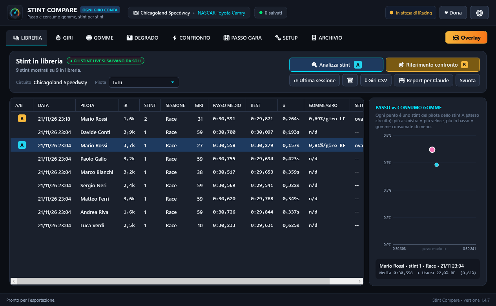

# Stint Compare

🇬🇧 [English](README.md)

**Analisi degli stint e overlay in diretta, gratuiti, per iRacing: confronta passo, usura gomme, carburante e setup, giro per giro.**



Stint Compare registra i tuoi giri in iRacing e ti aiuta a capire passo, consumo gomme, carburante e setup, confrontandoti con te stesso e con gli altri piloti.

## Download

👉 **[Ultima versione](https://github.com/ugf-creator/StintCompare/releases/latest)**

1. Scarica il file `.zip` dall'ultima release.
2. Estrailo in una cartella a tua scelta e avvia **StintCompare.exe**. Non c'è nulla da installare.
3. Tieni l'app aperta mentre iRacing è in esecuzione. Basta questo: i giri vengono registrati in automatico.

**Requisiti:** PC Windows e iRacing.

## Cosa fa

- **Registrazione automatica** di ogni giro, tuo e degli avversari: tempo, settori, carburante (solo tuo), incidenti, meteo e condizioni della pista.
- **Analisi gomme**: temperature a tre zone, pressioni e battistrada rimanente, lette a ogni sosta.
- **Briefing sul degrado**: calo di passo al giro, quanto avrebbero retto gomme e benzina, e cosa ha deciso la sosta.
- **Confronto tra stint** (A contro B): passo, best, consistenza, benzina e usura, giro per giro e per settore.
- **Passo gara** di tutti i piloti della sessione.
- **Confronto setup** tra gli stint salvati.
- **Overlay in diretta** per prove, qualifica e gara.
- **Report per Claude**: esporta una sessione in un file `.md` da allegare a Claude o a un'altra IA per farla analizzare.
- Disponibile in italiano e inglese, con unità metriche o imperiali.

## Documentazione

- 📖 [Manuale d'uso (Italiano)](docs/Manuale_IT.md)
- 📖 [User manual (English)](docs/Manual_EN.md)

## Avviso di Windows SmartScreen

Stint Compare è un piccolo progetto indipendente e l'`.exe` **non è firmato digitalmente** (i certificati di firma costano). Per questo Windows può mostrare *"Windows ha protetto il PC"* la prima volta che lo avvii:

1. Clicca su **Ulteriori informazioni**.
2. Clicca su **Esegui comunque**.

Anche alcuni antivirus possono segnalare gli eseguibili non firmati. Se vuoi verificare il file scaricato:

- Confronta l'hash SHA-256 dello zip con quello pubblicato nelle note della release. In PowerShell:
  ```
  Get-FileHash .\StintCompare-x.y.z.zip -Algorithm SHA256
  ```
- Controlla il link a VirusTotal nelle note della release.

## Privacy

Tutti i tuoi dati restano sul tuo PC, in `Documenti\StintCompare`. L'app si collega a internet solo all'avvio, per controllare se è disponibile una nuova versione. Non viene inviato nient'altro: il file "Report per Claude" viene creato in locale e sei tu a decidere dove allegarlo.

I file di sessione contengono i nomi degli altri piloti presenti nella sessione. Tienine conto prima di condividerli pubblicamente.

## Supporto e segnalazioni

- 💬 Discord: **[link d'invito qui]**
- Segnalazioni di bug e richieste di funzioni si gestiscono su Discord.

Il supporto è offerto "best effort", senza tempi di risposta garantiti.

## Sostieni il progetto

Stint Compare è gratuito. Se lo trovi utile e vuoi sostenerne lo sviluppo, puoi lasciare una donazione volontaria su Ko-fi. Le donazioni non danno diritto a supporto o a funzioni specifiche.

☕ **[ko-fi.com/stintcompare](https://ko-fi.com/stintcompare)**

## Licenza

Uso gratuito, personale e non commerciale. Ridistribuzione e modifica non sono consentite. Dettagli nel file [LICENSE](LICENSE).

## Disclaimer

Stint Compare è un progetto indipendente. **Non è affiliato, approvato né sponsorizzato da iRacing.com Motorsport Simulations.** iRacing è un marchio del rispettivo proprietario.
