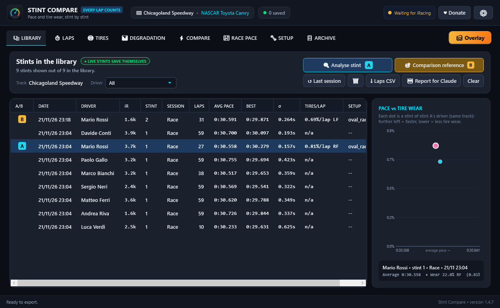

# Stint Compare

🇮🇹 [Italiano](README.it.md)

**Free stint analysis and live overlay for iRacing: compare pace, tyre wear, fuel and setups, lap by lap.**



Stint Compare records your laps in iRacing and helps you understand pace, tyre wear, fuel and setup, comparing you with yourself and with other drivers.

## Download

👉 **[Latest release](https://github.com/ugf-creator/StintCompare/releases/latest)**

1. Download `StintCompare-x.y.z.zip` from the latest release.
2. Extract it to any folder and run **StintCompare.exe**. There is nothing to install. The app itself tells you when a new version is out.
3. Keep the app open while iRacing is running. That's it: laps are recorded automatically.

**Requirements:** Windows PC and iRacing.

## 📝 Changelog

See [CHANGELOG.md](CHANGELOG.md).

## What it does

- **Automatic recording** of every lap, yours and your opponents': lap time, sectors, fuel (yours only), incidents, weather, track conditions and pit stops.
- **Tyre analysis**: three-zone temperatures, pressures and remaining tread, read at every pit stop.
- **Degradation briefing**: pace loss per lap, how long your tyres and your fuel would have lasted, and which one decided the pit stop.
- **Stint comparison** (A vs B): pace, best lap, consistency, fuel and wear, lap by lap and by sector.
- **Race pace chart** for all drivers in the session.
- **Setup comparison** across saved stints, up to 4 setups side by side.
- **Live overlay for VR and monitors** for practice, qualifying and race: live comparison with your reference stint, tyre temperatures, wind, gaps and a race grid that updates in real time. It steps aside by itself in the garage.
- **Report ready for AI**: export a session as a `.md` file to attach to Claude or any other AI assistant for analysis.
- **Light and local**: runs on your PC and keeps your data there (it only checks for updates at startup). Works with Garage61 and OpenKneeboard.
- Available in English, Italian, German, French and Spanish, with metric or imperial units.

## Documentation

- 📖 [User manual (English)](docs/StintCompare_Manual_EN.pdf)
- 📖 [Manuale d'uso (Italiano)](docs/StintCompare_Manuale_IT.pdf)

## Windows SmartScreen warning

Stint Compare is a small independent project and the `.exe` is **not digitally signed** (code-signing certificates are expensive). For this reason Windows may show *"Windows protected your PC"* the first time you run it:

1. Click **More info**.
2. Click **Run anyway**.

Some antivirus programs may also flag unsigned executables. If you want to check your download:

- Compare the SHA-256 hash of the zip with the one published in the release notes. In PowerShell:
  ```
  Get-FileHash .\StintCompare-x.y.z.zip -Algorithm SHA256
  ```
- Check the VirusTotal link in the release notes.

## Privacy

All your data stays on your PC, in `Documents\StintCompare`. The app only contacts the internet at startup to check whether a new version is available. Nothing is sent anywhere else: the "Report for Claude" file is created locally and it is up to you to attach it wherever you want.

Session files contain the names of the other drivers in the session. Keep that in mind before sharing them publicly.

## Support and feedback

- 💬 Discord: **https://discord.gg/77Ef4aQUc5**
- Bug reports and feature requests are handled on Discord.

Support is provided on a best-effort basis, with no guaranteed response times.

## Support the project

Stint Compare is free. If you find it useful and want to support its development, you can leave a voluntary donation on Ko-fi. Donations do not give any right to support or to specific features.

☕ **[ko-fi.com/stintcompare](https://ko-fi.com/stintcompare)**

## License

Free to use for personal, non-commercial purposes. Redistribution and modification are not permitted. See [LICENSE](LICENSE) for details.

## Disclaimer

Stint Compare is an independent project. It is **not affiliated with, endorsed by or sponsored by iRacing.com Motorsport Simulations**. iRacing is a trademark of its respective owner.
